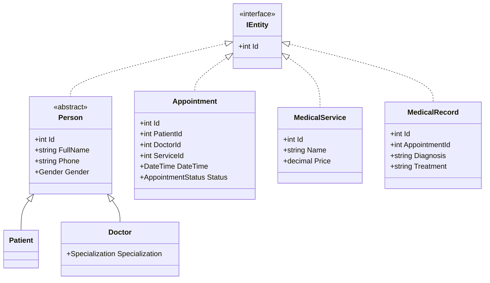
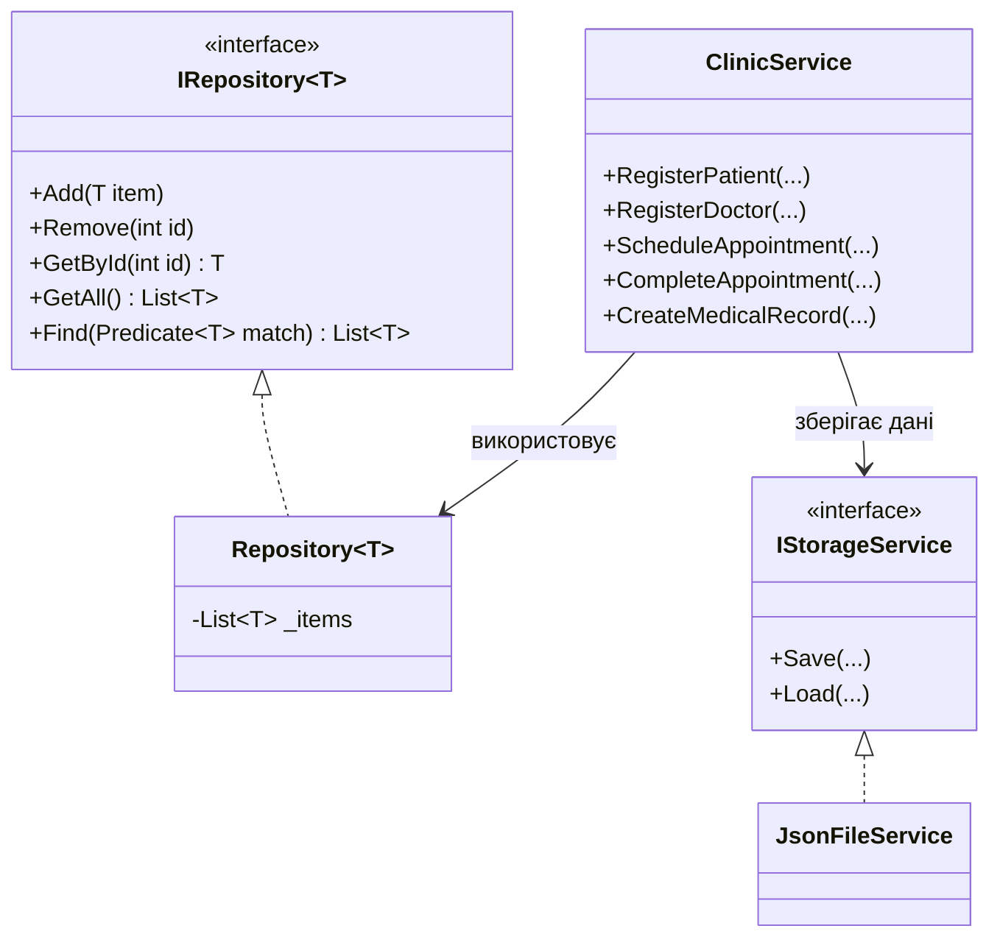
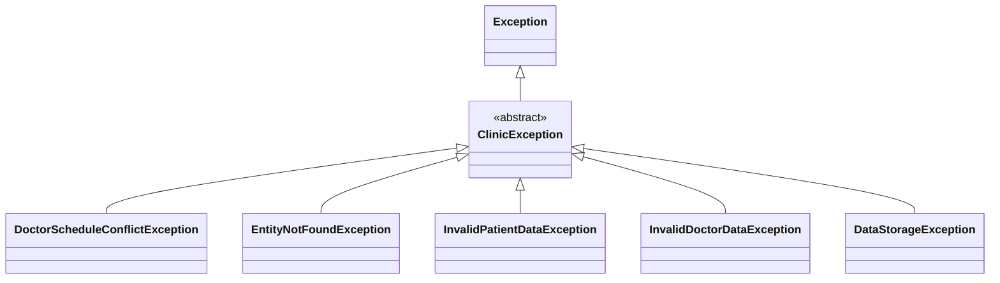

# Medical Clinic

Два проекти в одному solution:

- `Clinic.Core` - Class Library (DLL): моделі, інтерфейси, репозиторій, компаратори, виключення, бізнес-логіка, JSON-сервіс.
- `Clinic.UI` - Console App: меню та введення/виведення. Посилається на `Clinic.Core`.

## Запуск

Потрібен .NET 8 SDK.

    dotnet run --project Clinic.UI

Або відкрийте `Clinic.sln` у Visual Studio 2022 і запустіть проект `Clinic.UI`.
Якщо .sln не відкривається, створіть свій:

    dotnet new sln -n Clinic
    dotnet sln add Clinic.Core/Clinic.Core.csproj Clinic.UI/Clinic.UI.csproj

Дані зберігаються у JSON-файлах у папці `Data` поруч із exe (bin/Debug/net8.0/Data).
Пункт меню 5 заповнює програму тестовими даними.

1. Діаграма моделей предметної області

2. Діаграма сервісів та сховища

3. Ієрархія власних класів виключень

